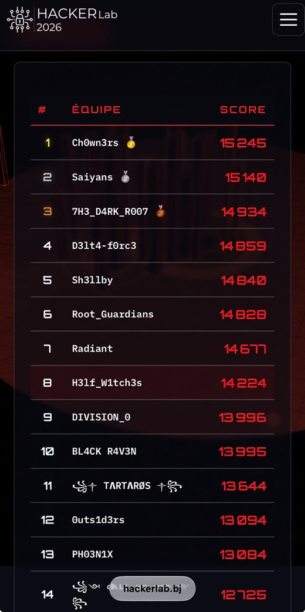

# HackerLab 2026 — Write-ups

Sélection de write-ups que j'ai rédigés pendant le **HackerLab 2026**, la
finale de cybersécurité organisée par l'**ASIN** dans le cadre du
**Cyber Africa Forum 2026** (Cotonou, Bénin, 15–17 novembre 2026).

Avec l'équipe **7H3_D4RK_R007**, nous terminons **3ᵉ** de la finale —
**14 934 points** — sur 20 équipes (80 finalistes, 48 heures, 210 challenges).

> Les flags des challenges hors ligne sont inclus lorsqu'ils sont connus ;
> ceux des challenges à instance, propres à chaque équipe, ne sont pas reproduits.

## Sommaire

| Mission | Challenge | Catégorie | Points | Write-up |
|---|---|---|---|---|
| AIZEN | AIZEN (Vantage Hosting) | Web | 200 | [`writeup-aizen-vantage-hosting-web-hard-200-pts.md`](aizen/aizen-vantage-hosting/writeup-aizen-vantage-hosting-web-hard-200-pts.md) |
| AIZEN | Fujiko Mine | Web-Crypto | 200 | [`writeup-fujiko-mine.md`](aizen/fujiko-mine/writeup-fujiko-mine.md) |
| AIZEN | Ishikawa Goemon | Web-HSM | 200 | [`writeup-ishikawa-goemon.md`](aizen/ishikawa-goemon/writeup-ishikawa-goemon.md) |
| AIZEN | Zenigata | Forensics | 200 | [`writeup-zenigata.md`](aizen/zenigata/writeup-zenigata.md) |
| Contingency Protocol | Contingency Protocol (Dossier Varga) | Web3 | 200 | [`writeup-contingency-protocol.md`](contingency-protocol/contingency-protocol-dossier-varga/writeup-contingency-protocol.md) |
| Ghost Authority | Ghost Authority (partie 1) | Forensics |  | [`writeup-ghost-authority.md`](ghost-authority/ghost-authority-partie-1/writeup-ghost-authority.md) |
| Ghost Authority | Ghost Authority (partie 2) | Forensics |  | [`writeup-ghost-authority-2.md`](ghost-authority/ghost-authority-partie-2/writeup-ghost-authority-2.md) |
| Human After All | Human After All 1 | Misc-Web | 100 | [`writeup-human-after-all-1.md`](human-after-all/human-after-all-1/writeup-human-after-all-1.md) |
| Inside Job | LockBox | Misc | 150 | [`writeup-lockbox.md`](inside-job/lockbox/writeup-lockbox.md) |
| Janus | Broken Channel | Forensics | 100 | [`writeup-broken-channel.md`](janus/broken-channel/writeup-broken-channel.md) |
| Janus | Canary | Misc | 200 | [`writeup-canary-janus.md`](janus/canary/writeup-canary-janus.md) |
| Janus | Conspiracy (note) | Forensics | 100 | [`conspiracy.md`](janus/conspiracy-note/conspiracy.md) |
| Janus | Final Trigger | Forensics |  | [`writeup-final-trigger.md`](janus/final-trigger/writeup-final-trigger.md) |
| Janus | Ghost Ratchet | Forensics | 100 | [`writeup-ghost-ratchet.md`](janus/ghost-ratchet/writeup-ghost-ratchet.md) |
| Janus | The Hunt | Forensics |  | [`writeup-the-hunt.md`](janus/the-hunt/writeup-the-hunt.md) |
| Kiss | Jericho | Forensics | 100 | [`writeup-jericho.md`](kiss/jericho/writeup-jericho.md) |
| Kiss | Papyrus | Forensics | 300 | [`writeup-papyrus.md`](kiss/papyrus/writeup-papyrus.md) |
| Memento The Fall of Memento | Under Seal | Misc-Forensics | 200 | [`memento.md`](memento/under-seal/memento.md) |
| Northline Interception | Last Departure | Web | 70 | [`writeup-last-departure.md`](northline-interception/last-departure/writeup-last-departure.md) |
| Northline Interception | THE GATE | Web | 70 | [`writeup-the-gate.md`](northline-interception/the-gate/writeup-the-gate.md) |
| Northline Interception | The Passenger | Web | 50 | [`writeup-the-passenger.md`](northline-interception/the-passenger/writeup-the-passenger.md) |
| Northline Interception | WINDOW | Web | 30 | [`writeup-window.md`](northline-interception/window/writeup-window.md) |
| Operation BATMAN | Operation BATMAN (HARMATTAN) | Web-OSINT (investigation policière) | 500 | [`writeup-harmattan.md`](operation-batman/operation-batman-harmattan/writeup-harmattan.md) |
| Operation Tervalis | Dead Drop (AIZEN Package 01) | Forensics-Crypto | 100 | [`writeup-aizen.md`](operation-tervalis/dead-drop-aizen-package-01/writeup-aizen.md) |
| Operation Tervalis | File Vault | Web-AD | 100 | [`writeup-file-vault.md`](operation-tervalis/file-vault/writeup-file-vault.md) |
| Operation Tervalis | Invisible Relay | Network-Forensics | 150 | [`writeup-invisible-relay.md`](operation-tervalis/invisible-relay/writeup-invisible-relay.md) |
| Operation Tervalis | Silent Broker | Web | 100 | [`writeup-silent-broker.md`](operation-tervalis/silent-broker/writeup-silent-broker.md) |
| Operation Tervalis | Subject File | Web-AD | 100 | [`writeup-subject-file.md`](operation-tervalis/subject-file/writeup-subject-file.md) |
| Sail Away | Catch me | OSINT | 100 | [`writeup-catch-me.md`](sail-away/catch-me/writeup-catch-me.md) |
| Sail Away | Flow in | Web | 150 | [`writeup-flow-in.md`](sail-away/flow-in/writeup-flow-in.md) |
| Sail Away | Welcome to the Machine | Crypto-Web | 100 | [`writeup-welcome-to-the-machine.md`](sail-away/welcome-to-the-machine/writeup-welcome-to-the-machine.md) |
| The Fugitive | The Fugitive | Misc | 200 | [`writeup-the-fugitive.md`](the-fugitive/the-fugitive/writeup-the-fugitive.md) |
| Toguro Tempest | Toguro Tempest | Misc | 500 | [`writeup-toguro-tempest.md`](toguro-tempest/toguro-tempest/writeup-toguro-tempest.md) |

## Méthode

Chaque dossier de challenge contient :

- `README.md` — contexte, auteur, catégorie, points ;
- `writeup-*.md` — le déroulé complet : reconnaissance, hypothèses, payloads,
  commandes exactes, sorties et validation.

Les write-ups sont rédigés en français et conservent les chemins de fichiers,
URLs et adresses de l'infrastructure de l'événement (environnement aujourd'hui
hors ligne).

## Licence

Les write-ups et les captures de ce dépôt sont publiés sous
**Creative Commons Attribution — Partage dans les mêmes conditions 4.0
International (CC BY-SA 4.0)**.

Vous pouvez les lire, les citer, les partager et les adapter, y compris
commercialement, à condition de créditer l'auteur et de diffuser toute
adaptation sous la même licence. Voir le fichier [LICENSE](LICENSE).

Les marques, logos et contenus de l'événement HackerLab / Cyber Africa Forum
restent la propriété de leurs détenteurs.
